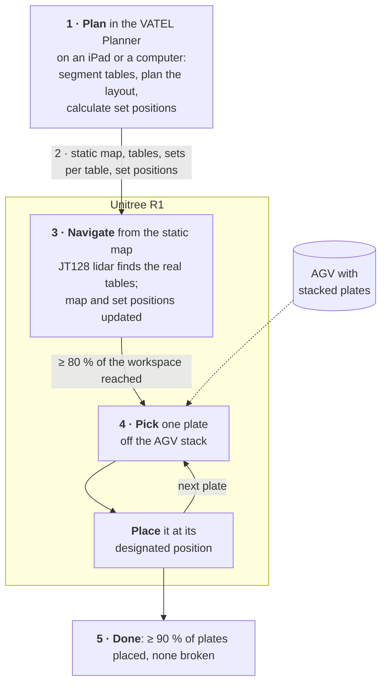

# VATEL: Humanoid Orchestration for Autonomous Banquet Setup

Banquet table setting requires handling diverse, fragile tableware across an environment
purpose-built for human reach and access, where fixed automation is impractical and a separate
task-specific robot per item type is uneconomical. VATEL develops and evaluates an autonomous
perception-and-manipulation pipeline for a humanoid robot to transfer and place banquet
tableware. The representative case is **plate transfer from an AGV**, a requirement from our
industry partner, who is deploying the AGV. The approach is intended to generalise to other
tableware handling tasks.

**Project report:** [cyanhere.github.io/VATEL-Humanoid-Orchestration-for-Autonomous-Banquet-Setup](https://cyanhere.github.io/VATEL-Humanoid-Orchestration-for-Autonomous-Banquet-Setup/)

## How it works

1. **Plan the banquet.** The banquet team opens the VATEL Planner on an iPad or a computer. It
   shows the whole banquet hall, segments out the tables and draws them on a 2-D map, where the
   team plans the arrangement and setup for the event.
2. **Hand the plan to the robot.** When the arrangement is done, the planner sends the static map
   to the Unitree R1 humanoid: where each table is, how many sets of plates and cutlery each
   table needs, and the calculated position of every set.
3. **Map the real hall and navigate.** The R1 navigates the hall autonomously from the planner's
   static map. Its onboard Hesai JT128 lidar maps the real room to find the exact location of
   each table, correcting the difference between the plan and the real arrangement. The robot
   updates the map and navigates to each set position.
4. **Transfer plates from the AGV.** Once the robot can navigate the whole hall and reach at
   least 80 % of the required workspace, it goes to the AGV plate-delivery area, where an AGV
   brings plates stacked from the kitchen. It takes one plate at a time off the stack and places
   it at its designated position. One plate per trip is a deliberate limit, set by the
   dexterous hands and the robot platform.
5. **Done.** The task is complete when the plates are at their designated positions, with up to
   10 % of all plates allowed to miss, and no plate broken.



### Success criteria

| Criterion | Target |
|---|---|
| Workspace the robot reaches by navigation | **≥ 80 %** of the required workspace |
| Plates at their designated positions | **≥ 90 %** of all plates (up to 10 % may miss) |
| Plates broken | **0** |
| Plates carried per trip | **1** |

## Hardware

| | |
|---|---|
| Robot | Unitree R1 humanoid: 26 DoF, 2 kg payload per arm |
| Head sensors | Hesai JT128 lidar and Intel RealSense D435if depth camera, on a custom clamp-on sensor helmet |
| Hands | BrainCo Revo 2 dexterous hands |
| Onboard compute | NVIDIA Jetson Orin |
| Plate delivery | AGV with stacked plates, deployed by our industry partner |
| Planner | Any web browser, on an iPad or a computer |

## Repository layout

```text
VATEL-Humanoid-Orchestration-for-Autonomous-Banquet-Setup/
├── planner/        # Steps 1–2  VATEL Planner web app and its link to the robot
├── navigation/     # Step 3     JT128 mapping, table-position correction, navigation to set positions
├── perception/     # Step 4     plate-stack detection on the AGV, plate pose in the robot frame
├── manipulation/   # Step 4     take one plate off the stack, carry it, place it
├── mission/        # Steps 2–5  on-robot executive that runs the plan and scores the result
├── hardware/       #            sensor helmet CAD, bill of materials, print files
└── docs/           #            CDE4301 report website (GitHub Pages)
```

Each folder's README covers that subsystem: what it does, how to run it, and its current status.

## Project report

The CDE4301 report is a static website in [`docs/`](docs/), built on the
[NUS EDIC report template](https://edic-nus.github.io/tutorial/) and published with GitHub Pages
(Settings → Pages → Deploy from a branch → `main`, folder `/docs`).

| Report | Link |
|---|---|
| Interim report, Semester 1 | [`docs/interim-report/`](https://cyanhere.github.io/VATEL-Humanoid-Orchestration-for-Autonomous-Banquet-Setup/interim-report/) |
| Final report, Semester 2 | to be published |

To preview the site locally, serve `docs/` and open <http://localhost:8000/>:

```bash
python -m http.server 8000 --directory docs
```

## Team

| Name | Department |
|---|---|
| Teh Wei Sheng | Mechanical Engineering |
| Song Cheng Yan | Mechanical Engineering |
| Soh Sze Juin | Electrical Engineering |

Supervisor: *to be added* · Industry partner: *to be added*

CDE4301 Innovation & Design Capstone, College of Design and Engineering, National University of
Singapore, AY2026/27.
